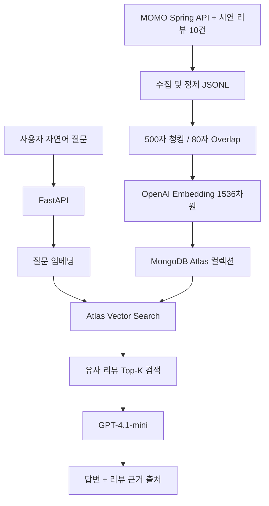

# MOMO Movie Search & Recommendation RAG

기존 MOMO 영화 서비스의 API와 시연 리뷰를 활용해 자연어 영화 검색·추천을 제공하는 RAG 웹 POC입니다.

## 프로젝트 정의
- 도메인: 영화 정보 검색, 감상 리뷰 검색, 취향 기반 영화 추천
- 대상 사용자: 영화 선택 전 작품 정보와 감상을 비교하려는 사용자
- 입력: “음악이 좋고 여운이 남는 SF 영화를 추천해줘.”
- 출력: 추천·검색 답변, 영화 정보, 리뷰 ID와 검색 근거
- 기존 서비스: MOMO Spring API의 영화 상세·추천 API
- 임베딩: OpenAI text-embedding-3-small (1536 dimensions)
- LLM: OpenAI gpt-4.1-mini
- 벡터 DB: MongoDB Atlas Vector Search
- 웹: FastAPI + HTML/CSS/JavaScript

## 1. 아키텍처와 데이터 흐름



## 2. 데이터 출처와 정제
- 리뷰 시연 데이터: 기존 MOMO 저장소의 `MOMO-RAG/scripts/seed.py`에 있는 가상 리뷰 10건
- 영화 메타데이터: MOMO `GET /api/movies/search`, `GET /api/movies/{movieCode}`
- 추천 후보: MOMO `GET /api/movies/recommendations`
- 정제: 필수 필드 검사, 리뷰 본문 공백 정규화, 영화 제목 정확 일치 확인, 영화 상세 메타데이터 결합
- 실제 회원 리뷰 본문이나 작성자 개인정보는 사용하지 않음

## 3. 청킹·임베딩 설계
- Chunk size: 500자
- Overlap: 80자
- 설계 근거: 짧은 감상 리뷰의 문맥을 유지하면서 검색 단위를 지나치게 크게 만들지 않도록 설정. 청크 경계는 문장·줄바꿈·공백을 우선 고려
- 임베딩 입력: 영화 제목 + 장르/감독/개봉일/줄거리 + 리뷰 제목 + 리뷰 본문
- 임베딩 모델: text-embedding-3-small, 1536차원

## 4. MongoDB Atlas Vector Search 설정

프로젝트 루트의 로컬 `.env`에 아래 값을 설정합니다. `.env`는 Git에 올리지 않습니다.

```env
MONGODB_URI=mongodb+srv://<username>:<password>@<cluster-host>/?retryWrites=true&w=majority&appName=momo-movie-rag
MONGODB_DATABASE=worklaw_db
MONGODB_COLLECTION=law_chunks
MONGODB_VECTOR_INDEX=vector_index
MONGODB_VECTOR_PATH=embedding
MONGODB_SERVER_SELECTION_TIMEOUT_MS=8000
```

Atlas에서 Database Access 사용자를 생성하고 Network Access에 현재 접속 IP를 허용해야 합니다. URI의 사용자명·비밀번호는 Atlas Database Access 계정 정보와 일치해야 합니다. 비밀번호에 `@ : / ? # [ ] $` 등의 예약 문자가 포함되면 URI 인코딩이 필요합니다.

컬렉션 `worklaw_db.law_chunks`에 Vector Search 인덱스 `vector_index`를 생성합니다. 인덱스 정의:

```json
{
  "fields": [
    {
      "type": "vector",
      "path": "embedding",
      "numDimensions": 1536,
      "similarity": "cosine"
    }
  ]
}
```

Atlas Vector Search 인덱스는 일반 MongoDB 인덱스와 다르므로 Atlas UI의 Search & Vector Search에서 생성해야 합니다. 인덱스 상태가 READY가 된 뒤 검색할 수 있습니다.

## 5. 실행

MOMO Spring Boot 백엔드를 먼저 실행합니다. 기본 주소는 `http://localhost:8111`입니다.

```bash
pip install -r requirements.txt
python scripts/collect_data.py
python scripts/build_index.py
uvicorn app.main:app --reload
```

- 웹: http://127.0.0.1:8000
- API 상태: GET /api/health
- 자연어 질문: POST /api/ask
- MOMO 추천 후보: GET /api/recommendations?genre=코미디
- API 문서: http://127.0.0.1:8000/docs

`build_index.py`는 실행 전 MongoDB ping을 수행하고, 성공한 경우에만 대상 컬렉션을 초기화한 뒤 임베딩을 저장합니다. 마지막에 실제 저장 문서 수와 청크 수가 일치하는지 검증합니다.

## 6. 평가와 개선
```bash
python -m pytest
python scripts/evaluate.py
```

8개 평가 질문에 기대 리뷰 ID를 라벨링하고 Recall@K, MRR@K를 측정합니다. 동일 평가셋에서 청킹 크기·overlap을 변경해 재색인하고 결과를 비교합니다. 실행하지 않은 수치를 보고서에 기재하지 않습니다.

## 7. 한계
- 리뷰는 시연용 가상 감상 10건으로 실제 사용자 선호를 대표하지 않음
- 평가 질문이 8개로 작아 일반화에 한계가 있음
- 리뷰는 주관적 감상이며 객관적 영화 사실의 근거가 아님
- Atlas Vector Search 인덱스가 READY 상태여야 검색 가능
- OpenAI API 네트워크 호출과 사용료가 발생
- MOMO 백엔드가 실행 중이어야 영화 상세 수집 및 추천 프록시를 사용할 수 있음
- 독립 POC로 MOMO 로그인·회원별 권한·원본 MySQL 데이터는 수정하지 않음

## 원본 프로젝트
- https://github.com/madison-yoon/MOMO
- https://github.com/madison-yoon/MOMO/blob/main/docs/RAG.md
- https://github.com/madison-yoon/MOMO/blob/main/MOMO-RAG/scripts/seed.py
