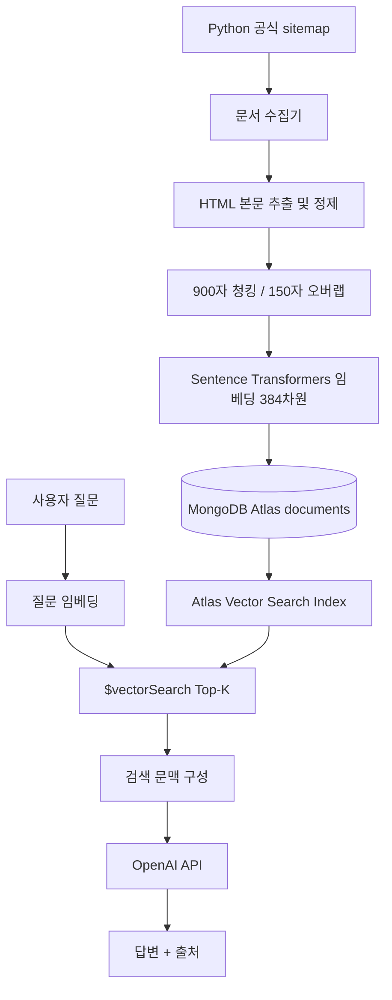

# 기술 문서

## 1. 프로젝트 정의

Python 3 공식 문서를 대상으로 사용자의 자연어 질문과 의미적으로 가까운 문서 청크를 검색하고, 검색 결과를 근거로 한국어 답변을 생성하는 RAG 웹서비스다.

- 대상 사용자: Python 학습자 및 개발자
- 입력: 자연어 질문, 선택적 Top-K
- 출력: LLM 답변, 원문 제목·URL·유사도·근거 발췌
- 데이터 출처: https://docs.python.org/3/

## 2. 아키텍처



## 3. 데이터 흐름

1. Python 공식 sitemap에서 문서 URL을 동적으로 수집한다.
2. HTTPS 및 `docs.python.org` 도메인만 허용한다.
3. HTML에서 본문을 추출하고 script/style/nav/footer 등 반복 UI를 제거한다.
4. 공백을 정리한 본문을 900자 단위로 나누고 청크 사이에 150자를 중첩한다.
5. 다국어 Sentence Transformers 모델로 384차원 정규화 임베딩을 생성한다.
6. URL과 청크 순번의 SHA-256을 문서 ID로 사용해 MongoDB에 upsert한다.
7. 질문도 같은 임베딩 모델로 벡터화하고 Atlas `$vectorSearch`로 Top-K를 검색한다.
8. 검색 청크만 OpenAI API에 전달하고 답변과 출처 정보를 반환한다.

## 4. MongoDB Atlas 설계

| 항목 | 값 |
|---|---|
| Database | worklaw_rag |
| Collection | documents |
| Vector index | vector_index |
| Vector field | embedding |
| Dimensions | 384 |
| Similarity | cosine |

문서 구조 예시:

```json
{
  "_id": "SHA-256(url#chunk)",
  "url": "https://docs.python.org/3/tutorial/...",
  "title": "문서 제목",
  "chunk": 0,
  "text": "정제된 문서 청크",
  "content_hash": "SHA-256(chunk text)",
  "embedding": [0.012, -0.034, 0.056]
}
```

Vector Search는 `$vectorSearch` 집계 단계에서 `embedding`을 대상으로 검색하고 `vectorSearchScore`를 반환한다. 임베딩 모델이 변경되면 차원과 벡터 의미 공간이 달라지므로 기존 벡터를 재생성해야 한다.

## 5. 주요 설계 결정

- Sentence Transformers의 다국어 모델을 사용해 영문 공식 문서와 한국어 질문 간 검색을 지원한다.
- 900자/150자 설정은 초기 기준값이며, 문맥 단절과 검색 단위 크기의 균형을 실험 대상으로 둔다.
- 문서 ID를 결정적으로 생성하고 upsert해 동일 URL·청크의 중복 적재를 방지한다.
- Atlas Vector Search를 유일한 벡터 저장·검색 계층으로 사용한다. 로컬 ChromaDB 대체 경로는 두지 않는다.
- LLM에는 검색된 문맥만 전달하고, 근거가 부족한 경우 모른다고 답하도록 지시한다.

## 6. 평가와 개선

평가 데이터는 `data/evaluation/questions.json`에 질문과 기대 키워드로 관리한다.

- Recall@K: 기대 키워드가 포함된 관련 청크가 Top-K 안에 하나 이상 검색된 질문의 비율
- MRR: 첫 관련 청크의 순위 역수를 전체 질문에 대해 평균한 값

실행:

```bash
python -m scripts.evaluate
```

평가 전후 결과를 같은 질문 세트와 K 값으로 비교한다. 개선은 청킹 크기·오버랩 또는 Top-K를 한 번에 하나씩 변경하고 재색인한 뒤 수행한다. 측정되지 않은 점수는 결과로 기입하지 않는다.

| 실험 | Chunk | Overlap | K | Recall@K | MRR |
|---|---:|---:|---:|---:|---:|
| 기준 | 900 | 150 | 5 | 실행 후 기록 | 실행 후 기록 |
| 개선 | 변경값 기록 | 변경값 기록 | 동일 K | 실행 후 기록 | 실행 후 기록 |

## 7. 실행 및 데모

기존 Conda 환경(Python 3.12 이상)에서 의존성을 설치하고 `.env`에 Atlas URI와 OpenAI 키를 설정한다. `uvicorn app.main:app --reload` 실행 후 웹 화면에서 문서 수집을 수행한다. `/api/health`에서 MongoDB 연결·문서 수·Vector Search 인덱스 준비 상태를 확인한 다음 질문하고 답변·출처를 시연한다.

## 8. 한계

- sitemap과 공식 문서 HTML 구조 변경에 영향을 받는다.
- 키워드 기반 평가는 의미적 관련성과 답변의 사실성을 완전히 측정하지 못한다.
- 벡터 검색은 문서에 존재하는 내용의 검색을 돕지만 생성 답변의 환각을 완전히 제거하지 않는다.
- Atlas Vector Search 인덱스 생성·빌드에 시간이 필요하며 Atlas 네트워크·권한 설정에 영향을 받는다.
- OpenAI API 사용량·결제 상태·네트워크 상태에 따라 답변 생성이 실패할 수 있다.
