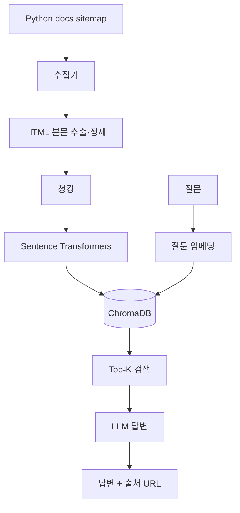

# 기술 문서

## 목적과 입출력
Python 3 공식 문서를 대상으로 자연어 질문에 관련 문서를 찾아 근거와 함께 답하는 RAG POC다. 대상은 Python 학습자·개발자이며 입력은 질문, 출력은 생성 답변과 원문 출처다.

## 아키텍처

## 데이터 구축
출처는 https://docs.python.org/3/ 이며 sitemap에서 URL을 동적으로 가져온다. 공식 도메인만 허용하고 본문에서 script/style/nav/footer 등을 제거한다. 제목·본문·URL을 추출하고 청크 URL·순번을 식별자로 사용해 upsert한다.

## 주요 설계
- 다국어 Sentence Transformers 임베딩으로 영문 문서와 한국어 질문의 교차 검색을 지원한다.
- ChromaDB PersistentClient로 색인을 로컬에 유지한다.
- 초기 청크는 900자, 오버랩은 150자이며 환경변수로 조절한다. 문맥 손실과 검색 단위 크기의 균형을 위한 초기값이며 실험으로 검증한다.
- LLM에는 검색 청크만 전달하고 문맥에 없는 내용은 모른다고 답하도록 지시한다.
- 답변과 별개로 검색된 원문 URL·유사도를 반환한다.

## 평가 및 개선
Recall@K는 기대 키워드를 포함한 관련 청크가 Top-K에 포함된 질문 비율, MRR은 첫 관련 청크 순위 역수의 평균이다. `python -m scripts.evaluate` 실행. 기준 900/150과 개선안 700/120을 동일 평가셋으로 비교한다. 평가 데이터는 질문과 관련 키워드만 포함하며 답변을 하드코딩하지 않는다. 실행 전 결과를 임의 기입하지 않는다.

| 실험 | Chunk | Overlap | K | Recall@K | MRR |
|---|---:|---:|---:|---:|---:|
| 기준 | 900 | 150 | 5 | 미측정 | 미측정 |
| 개선 | 700 | 120 | 5 | 미측정 | 미측정 |

## 데모
Windows CMD에서 venv 생성 → requirements 설치 → .env 생성 및 API 키 입력 → `uvicorn app.main:app --reload` → 웹 화면에서 공식 문서 색인 → 질문 → 답변과 출처 확인 → 평가 스크립트 실행.

## API
- GET /api/health: 색인 청크 수
- POST /api/ingest: sitemap 수집 및 색인
- POST /api/ask: 검색 및 LLM 답변 생성

## 한계
Sitemap과 HTML 구조 변경에 취약하다. 키워드 평가셋은 의미적 관련성을 완전히 측정하지 못하며 크기가 작다. 생성 답변의 환각과 인용 정합성은 별도 사람 평가가 필요하다. Python 문서 버전과 수집 시점에 따라 내용이 달라질 수 있다.
