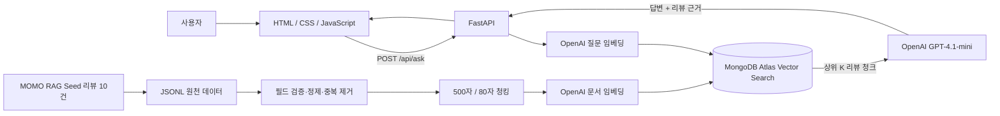

# MOMO Movie Review RAG 아키텍처

## 색인 데이터 흐름
MOMO RAG Seed 코드 → 시연 리뷰 10건 JSONL → 필수 필드 검사·공백 정리·중복 제거 → 리뷰 청킹 → OpenAI 임베딩 → MongoDB Atlas 저장.

## 질문 데이터 흐름
1. 사용자가 영화명이나 감상 요소를 포함한 자연어 질문을 입력한다.
2. FastAPI가 질문을 OpenAI 임베딩 모델로 벡터화한다.
3. MongoDB Atlas Vector Search가 cosine 유사도로 관련 리뷰 청크를 검색한다.
4. 검색된 리뷰 본문과 리뷰 ID·영화명·제목을 GPT 모델에 전달한다.
5. LLM은 제공된 리뷰 근거 안에서 답변하고, 답변에는 리뷰 ID 인용을 표시한다.
6. 화면은 답변과 검색된 리뷰 원문, 출처 링크, 유사도 점수를 표시한다.

## 주요 설계 결정
- MOMO 프로젝트에 존재하는 RAG의 리뷰 중심 데이터 계약과 Atlas/OpenAI 구성을 재사용한다.
- 실제 회원 데이터 대신 MOMO 저장소에 이미 정의된 시연용 가상 리뷰 10건을 사용한다.
- MongoDB Atlas를 벡터 저장소로 사용하고 임베딩은 OpenAI `text-embedding-3-small`으로 통일한다.
- 리뷰 ID와 영화 코드를 유지해 검색 결과를 원본 리뷰 단위로 추적한다.
- 청킹 설정과 top-k는 환경 설정으로 관리한다.
- API 키와 MongoDB URI는 Git에 포함하지 않는다.

## 구성 요소
| 경로 | 책임 |
|---|---|
| `scripts/collect_data.py` | MOMO Seed JSONL 검증·정제 |
| `app/rag/chunker.py` | 리뷰 텍스트 청킹 |
| `app/rag/embedder.py` | 문서·질문 임베딩 |
| `app/rag/vector_store.py` | Atlas 저장·Vector Search |
| `app/rag/retriever.py` | 검색 흐름 |
| `app/rag/generator.py` | 근거 기반 답변 생성 |
| `app/main.py` | FastAPI 및 웹 화면 제공 |
