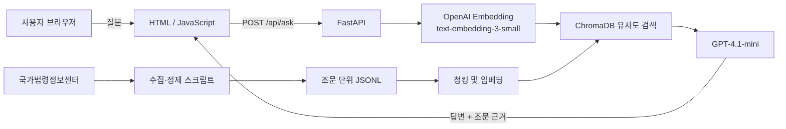

# 시스템 아키텍처

## 온라인 질의 흐름

1. 브라우저에서 자연어 질문을 전송한다.
2. 서버가 질문을 1,536차원 벡터로 변환한다.
3. ChromaDB가 cosine distance 기준 상위 5개 chunk를 반환한다.
4. 검색 chunk를 출처 메타데이터와 함께 GPT-4.1-mini에 전달한다.
5. 모델은 제공된 근거 범위 안에서 답변하고, 서버는 답변과 검색 근거를 함께 반환한다.

## 오프라인 인덱싱 흐름

공식 법령 페이지 수집 → 본문 정리 → 조문별 JSONL 저장 → 500자 chunk / 80자 overlap → OpenAI 임베딩 → ChromaDB 영구 저장.

## 주요 설계 결정

- 조문을 먼저 분리한 뒤 청킹해 조문 번호와 제목이 chunk metadata에 남도록 했다.
- 500자 크기는 짧은 법 조문에서 검색 단위를 과도하게 잘게 나누지 않으면서 검색 문맥을 제한하기 위한 초기값이다.
- 80자 overlap은 경계에서 의미가 끊기는 문제를 완화하기 위한 초기값이며 평가 결과로 조정한다.
- 벡터 저장소는 2시간 POC에서 별도 서버 설정을 줄이기 위해 로컬 영속형 ChromaDB를 선택했다.
- API 키와 벡터 DB 파일은 저장소에 포함하지 않는다.
