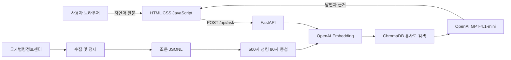

# 시스템 아키텍처

## 질의 데이터 흐름
1. 브라우저가 질문을 FastAPI에 전달한다.
2. text-embedding-3-small로 질문을 벡터화한다.
3. ChromaDB가 cosine distance 기준 상위 5개 chunk를 검색한다.
4. 검색된 조문 텍스트와 메타데이터를 gpt-4.1-mini에 전달한다.
5. 생성 답변과 검색된 조문·공식 원문 링크를 브라우저에 반환한다.

## 인덱싱 데이터 흐름
국가법령정보센터 → HTML 본문 추출 → 조문 JSONL → 조문별 청킹 → OpenAI 임베딩 → ChromaDB 영구 저장.

## 주요 설계 결정
- 2시간 POC에서 별도 DB 서버 구성을 줄이기 위해 로컬 영속형 ChromaDB를 선택했다.
- 조문 번호와 출처를 metadata에 보존해 근거를 표시한다.
- 500자/80자 설정은 초기값이며 평가 결과로 조정한다.
- API 키와 벡터 DB 데이터는 Git에 포함하지 않는다.
