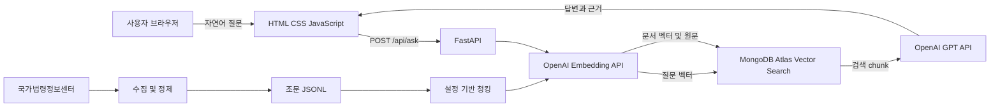

# 시스템 아키텍처

## 질의 데이터 흐름
1. 브라우저가 자연어 질문을 FastAPI에 전달한다.
2. OpenAI 임베딩 모델로 질문을 벡터로 변환한다.
3. MongoDB Atlas Vector Search가 설정된 유사도 기준으로 관련 chunk를 검색한다.
4. 검색된 조문 텍스트와 메타데이터를 설정된 OpenAI 채팅 모델에 전달한다.
5. 생성 답변과 검색된 조문·공식 원문 링크를 브라우저에 반환한다.

## 인덱싱 데이터 흐름
국가법령정보센터 → HTML 본문 추출 → 조문 JSONL → 조문별 청킹 → OpenAI 임베딩 → MongoDB 저장.

## 주요 설계 결정
- 벡터 저장소는 MongoDB Atlas Vector Search로 통일한다.
- 문서 원문, 임베딩, 조문 식별자, 제목, 공식 출처를 하나의 chunk 문서로 저장한다.
- chunk ID를 MongoDB `_id`로 사용하고 upsert로 재색인 시 중복 저장을 방지한다.
- 벡터 인덱스 필드와 이름, 차원은 환경 설정으로 관리한다.
- chunk 크기, overlap, 검색 개수는 환경 설정으로 관리한다.
- API 키와 MongoDB 연결 문자열은 Git에 포함하지 않는다.
